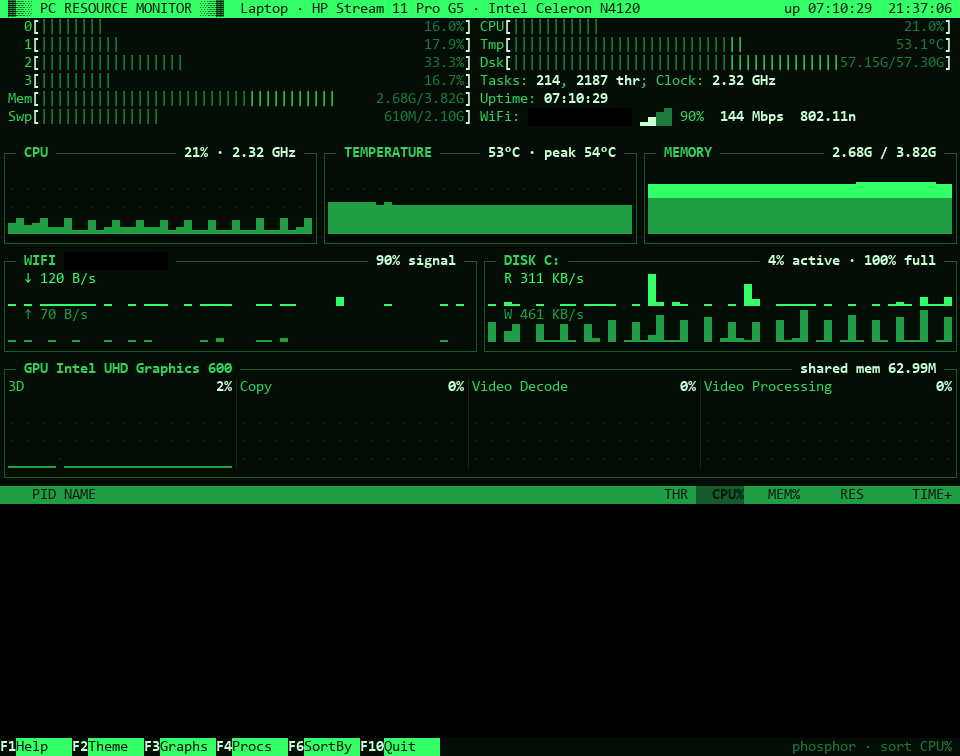

# pc-resource-monitor
my take on htop with the help of claude code

a retro terminal monitor for windows. shows cpu, temperature, ram, wifi, disk and the gpu engines task manager has (3d, copy, video decode, video processing), plus a process list.



## run it

from [releases](https://github.com/glimmercharger/pc-resource-monitor/releases) grab either:

- `resourcemonitor-setup.exe` - installs it (no admin needed), adds it to the start menu and gives you a `resourcemonitor` command in any terminal
- `resourcemonitor-portable.exe` - just run it, nothing to install

looks best in windows terminal.

| key | does |
|---|---|
| F1 / h | help |
| F2 / t | change theme (htop, phosphor, amber, c64) |
| F3 / g | graphs on/off |
| F4 / p | process list on/off |
| F6 / s | sort by cpu, mem, pid or name |
| ↑ ↓ | scroll the process list |
| F10 / q | quit |

`-theme amber` starts on a theme, `-delay 2s` updates less often.

## build

needs go 1.27, and [inno setup](https://jrsoftware.org/isinfo.php) for the installer

```
.\build.ps1 -Version v1.0.0
```
